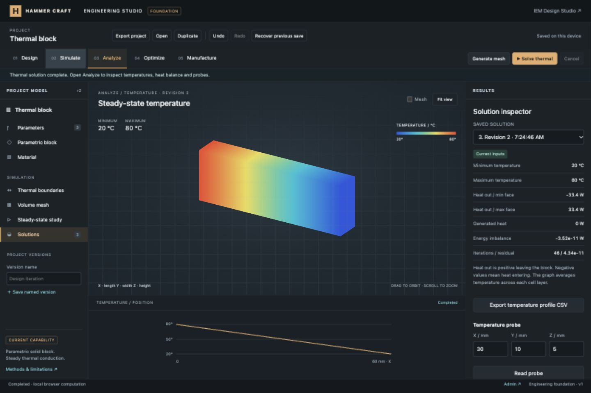
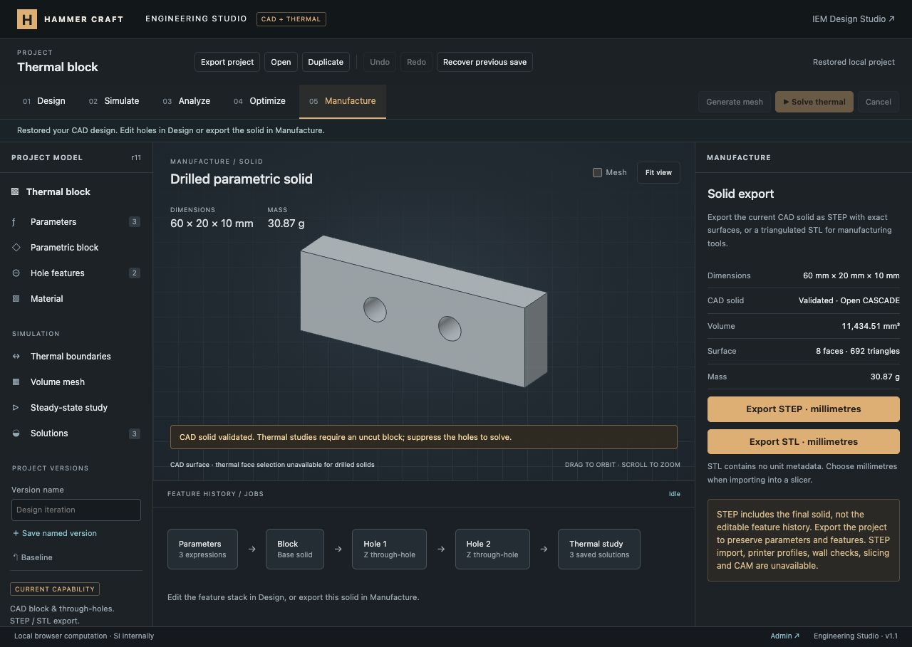
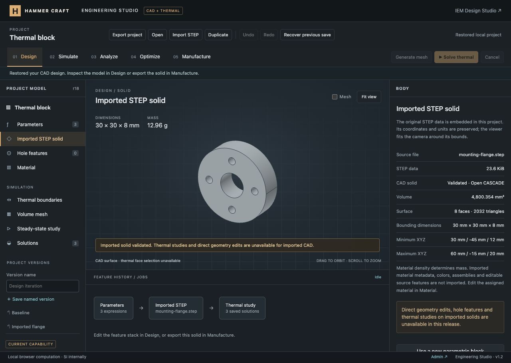
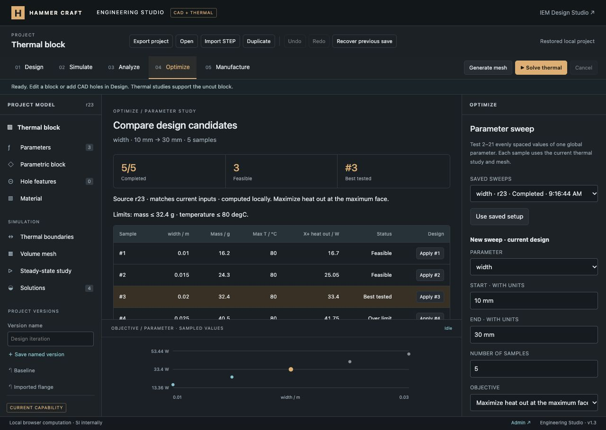
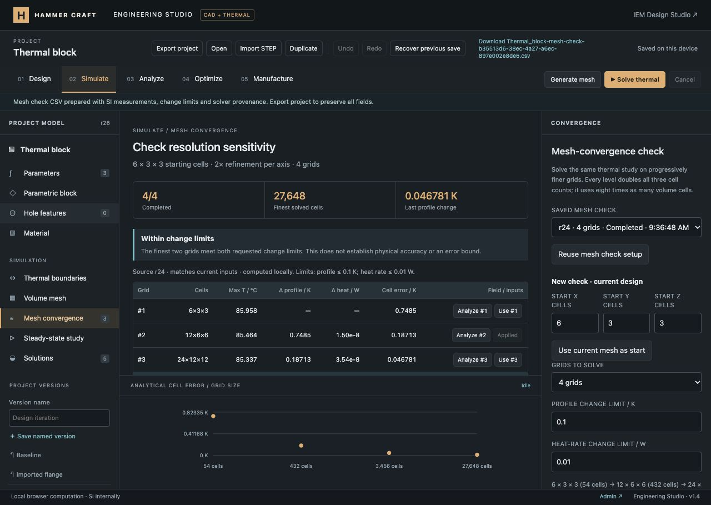
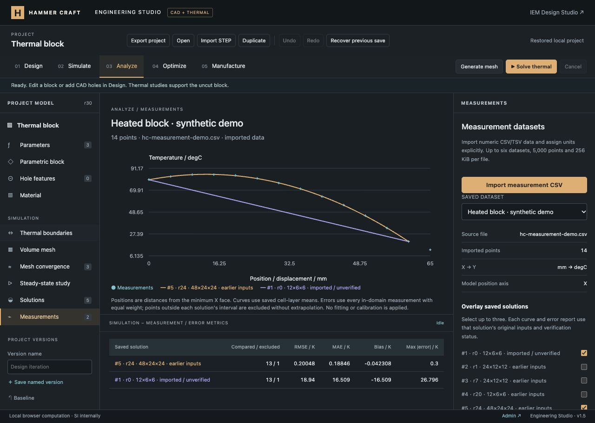
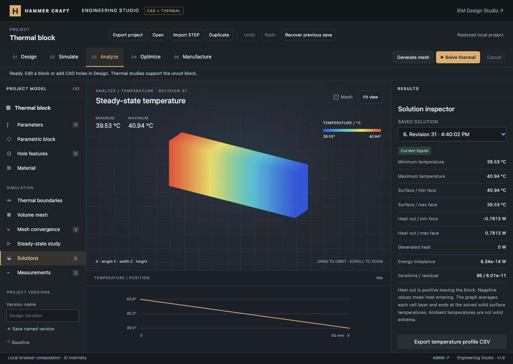

# Engineering Studio CAD, thermal studies and measurement comparisons — verification

Implemented the first general engineering workflow: parameterized solid block → material → thermal boundary faces → structured volume mesh → steady thermal solve → fields, profile, probes and saved provenance.

Continued with a real Open CASCADE solid-modeling milestone: parametric through-hole features, intersection-aware Boolean subtraction, topology validation, CAD tessellation, measured volume/mass, STEP and binary STL export. No runtime CDN or remote compute service is used.

Added validated STEP import as an undoable model replacement, with embedded source data, preserved file units/coordinates, named-version support and protection against cancelled or stale asynchronous imports.

Added a working Optimize workspace with unit-aware one-variable sweeps, real thermal solves, objective ranking, mass/temperature limits, candidate comparison, sampled plots, CSV, bounded project persistence and undoable application of full candidate inputs.

Added mesh-convergence checks in Simulate: independent solves on two to four uniformly refined grids, profile/heat-rate comparisons, an analytical temperature-error benchmark, retained fields, undoable input application and CSV export.

Added measurement import in Analyze, with bounded CSV/TSV parsing, explicit quantities/units and column mapping, generic XY plots, up to three saved thermal overlays, per-point differences, aggregate error metrics, source-file persistence and undoable dataset management.

Added convection boundary conditions on either or both block end faces, with unit-aware ambient temperatures and heat-transfer coefficients, actual solid surface temperatures, and integration with probes, measurements, sweeps and mesh checks.

## Automated checks

- `node --test tests/engineering.test.mjs tests/engineering-cad.test.mjs tests/engineering-sweep.test.mjs tests/engineering-convergence.test.mjs tests/engineering-measurement.test.mjs tests/engineering-convection.test.mjs`: 88 passing tests (17 thermal/project, 18 CAD/import, 12 sweep, 13 convergence, 14 measurement and 14 convection).
- `node --test tests/*.test.mjs`: 431 passing tests, including the existing IEM, acoustic, circuit, geometry and payment regression suite.
- `git diff --check`: clean.
- A dedicated GitHub Actions workflow runs the new engineering tests on relevant pushes and pull requests. Remote CI has not been run during this local implementation.

The analytical benchmarks cover all three conduction axes; the default example gives 33.4 W heat flow and 50 °C at the centre. Uniform internal heat generation conserves energy and shows second-order convergence under refinement. The largest preset (16,000 cells) also completed locally with a residual below the target tolerance.

The checked-in WASM kernel matches the analytical volume of a drilled block along X/Y/Z, and the intersection volume of two perpendicular equal-radius cylinders. STEP export re-imports with matching solid volume; binary STL has positive outward volume within tessellation tolerance. Tests also exercise real CAD worker messages, stale-export rejection, cancellation, timeout/retry state, suppression, invalid geometry/units/IDs, immutable thermal snapshots and asset checksums. A 60 × 20 × 10 mm block with a 6 mm Z-axis hole has volume 11,717.256661 mm³; two non-overlapping holes give 11,434.513322 mm³ and mass 30.873185970 g at 2700 kg/m³.

## Browser checks

Used the repository's loopback-only preview server, without production authentication or account data.

- Solved the default block and displayed the computed field/profile.
- Doubled its length: earlier solution became outdated, retained its original geometry, and the new solution produced 16.7 W.
- Read the centre probe: 50 °C.
- Rejected `5 V` as a block dimension without replacing accepted geometry.
- Reloaded and recovered the autosaved project and its solutions.
- Imported a project through the native file chooser: imported solutions were visibly marked unverified.
- Duplicated a project: the copy retained inputs and started with no results. Recovery restored the previous project.
- Saved a named input version.
- Applied the Fine preset and generated/solved 3,456 hexahedral control volumes.
- Checked 1440 × 960 desktop and 390 × 844 mobile layouts; the mobile page had no horizontal overflow. Reset the temporary viewport override afterwards.
- No browser console errors were reported during the checked flows.

Project, CSV and STL export use standard browser Blob download links. The project export action generated a persistent downloadable link, and serialized contents/round trips/STL geometry are covered by tests. The in-app browser's automation did not report a completed download event, so actual file-download completion was not confirmed there. File import was verified separately using a locally generated project fixture.

## CAD browser checks

- Added a visible Z-axis through-hole, changed its diameter to 6 mm and inspected the kernel-measured volume/mass.
- Rejected a 50 mm hole without replacing the accepted geometry; the invalid form remained an unapplied draft.
- Verified active holes disable thermal mesh/solve and saved thermal results retain the original uncut geometry with an outdated banner.
- Suppressed a hole and checked thermal availability; undo/redo and a new thermal solve completed successfully.
- Reloaded and regenerated the saved drilled model with its stable feature IDs and existing solutions.
- Created two independent holes using `length / 3` and `2 * length / 3` center expressions.
- Manufacture displayed the measured final volume and prepared a STEP Blob download link. The in-app browser again did not report a completed download event; disk delivery is unconfirmed. STEP contents and real-kernel re-import are verified by automated tests.
- Checked the final desktop view and 390 × 844 mobile Manufacture/Hole features layouts. Both mobile pages had `scrollWidth === clientWidth === 390`; reset the viewport override afterwards.
- No browser warning/error logs were reported for the checked final flows.

## STEP import checks

- Real-kernel tests cover millimetre, metre and inch files and preserve an off-origin cylinder's dimensions, position and volume through import and re-export.
- Malformed, truncated, binary and oversized input is rejected. Valid STEP files containing multiple solids, an open surface or a loose face outside the solid are rejected.
- Transaction tests verify that validation precedes the commit, newer edits prevent replacement, cancelled and failed imports preserve the accepted model, and cancellation remains effective while a project replacement awaits storage.
- Browser file-picker import of `engineering/examples/mounting-flange.step` displayed a curved flange with central bore and four mounting holes: 30 × 30 × 8 mm, 4,800.354 mm³, 12.96 g at 2700 kg/m³, with bounds (30, −45, 12) to (60, −15, 20) mm.
- A multi-solid STEP file was rejected without creating an undo entry. Undo returned to the original two-hole block; redo restored the imported flange.
- Analyze retained the original thermal result and block geometry with an outdated banner. Imported geometry could not enable thermal solving.
- Reload regenerated the embedded STEP solid; a named imported version restored it after creating a new parametric block. Changing the assigned material to copper updated mass to 43.01 g without changing geometry, then aluminum was restored.
- Opened a portable project containing STEP data through the file picker and recovered the prior project, including its imported geometry, three thermal results and named versions.
- Checked the imported-body inspector at 390 × 844 and the normal desktop viewport. The mobile page had no horizontal overflow. Reserved space above/below CAD rendering keeps tall imported shapes clear of dimensions and status text; the viewport fits the displayed vertices around their original bounds. Reset the viewport override after testing.
- The final checked browser flows produced no warning/error logs. Download delivery remains subject to the in-app-browser limitation recorded above; the import and project-recovery workflows were verified directly.

## Parameter sweep checks

- Independent analytical tests check every length sample's mass, fixed-boundary temperature extrema, heat rate and conservation. Sweeping 30–120 mm gives 66.8–16.7 W on the maximum X face. Tests also cover dependent geometry, parameterized conductivity and Celsius boundary temperatures.
- Constraints include equality, rank only feasible successful samples, and explicitly report when none are feasible. Invalid geometry and rejected physical solutions have diagnostic rows; remaining samples continue.
- Tests verify full-input apply/undo, a repeat solve matching the selected metrics, old project compatibility, imported verification flags, five-run retention, partial records, corrupted fingerprints/diagnostics, SI CSV escaping, immutable worker options, cancellation and a real module worker sweep.
- In the browser, a seven-sample length sweep returned the expected heat-flow trend and excluded masses above 40 g. Applying sample #7 produced a 120 × 20 × 10 mm block, 64.8 g; a fresh Analyze result showed 16.7 W. Undo restored the baseline and the sweep still matched its original source.
- `5 V` as a length endpoint was rejected without changing the design. A −10–10 mm range retained two invalid-geometry diagnostics and one computed sample. A 1 g mass limit correctly produced no feasible candidate.
- Cancelled a 21-sample sweep on the Extreme mesh after seven completed samples. The record remained explicitly Cancelled with 7/21 samples, retained those values after reload, and ignored later worker output.
- Opened a portable sweep fixture through the file picker and verified the visible “imported metrics · unverified” state. Recovered the working project with its prior thermal solutions, named versions and saved sweeps.
- A final width sweep of 10–30 mm maximized X+ heat out with mass ≤32.4 g and temperature ≤80 °C. It selected sample #3 (20 mm, 32.4 g, 33.4 W) as the best of three feasible candidates out of five solved samples.
- CSV preparation produced the downloadable Blob link. CSV content/provenance are covered by automated tests; actual file delivery remains unconfirmed in the in-app browser as described above.
- Checked the comparison and setup at 390 × 844 and the normal desktop size. Horizontal scrolling is contained within the data table; the page width remains 390 px. The mobile comparison grows to show its content. Reset the viewport override after testing.

## Mesh-convergence checks

- Analytical tests cover linear conduction and uniform generation along X/Y/Z. The generation benchmark independently checks maximum cell error against `|q| h² / (8k)` and a fourfold decrease when cell spacing halves.
- Tests cover refinement bounds, unsupported geometry, the maximum difference between interpolated profiles, failed-grid diagnostics, partial and imported records, immutable worker inputs, cancellation/late-message handling and a real module worker run.
- Persistence tests check legacy projects, three-record retention, full-field round trips, imported verification flags, shared result identity, conflicting fields, tampered source/solver settings, full-input apply/undo, stale results and SI CSV escaping.
- In the browser, the default linear case met its change limits across three grids. With `1e7 W/m^3` generation, the same three-grid plan exceeded the 0.1 K profile limit. Adding a fourth grid met both limits, with a final profile change of 0.0467814 K and heat-rate change of about 4.87e-8 W.
- The heated example solved 54, 432, 3,456 and 27,648 cells. Measured analytical cell errors were 0.748503, 0.187126, 0.0467814 and 0.0116954 K. The finest field reported 26.6 W and 93.4 W outward boundary heat, matching the 120 W internal source within iterative tolerance.
- Analyze opened the retained finest field without rerunning it; Use applied all of its inputs, made the field current, and Undo restored the displaced mesh. Opening the same field again did not duplicate it in saved solutions.
- An oversized four-grid plan was rejected before starting a worker. Saved checks survived reload. Reusing a selected check copied its settings into the new-run form while preserving the current design.
- Imported a portable mesh-check fixture through the file picker. Both the comparison and Analyze marked imported fields unverified, and the comparison withheld the change-limit assessment. Recovery restored the working project with its solutions, named versions, sweeps and mesh checks.
- CSV preparation produced the downloadable Blob link. CSV contents are tested; actual download delivery remains unconfirmed in the in-app browser as described above.
- Checked the comparison and setup at 390 × 844 and the normal desktop size. The page width remained 390 px, with horizontal scrolling contained inside the measurements table. Reset the temporary viewport override afterwards. Optimize still displayed its saved sweep correctly after the shared comparison-view changes.
- The checked final browser flows produced no warning/error logs.

## Measurement import and comparison checks

- Tests cover CSV quoting, escaped quotes, BOM, CRLF, embedded newlines, comma/semicolon/tab delimiters, blank records, arbitrary columns, duplicate positions, finite-number validation, malformed/oversized files, column/point limits and all supported quantity/unit pairs.
- Independent linear-conduction benchmarks verify RMSE, MAE, signed bias and maximum absolute error. X/Y/Z cases check axis matching and endpoints. Tests prove that the heated coarse-grid prediction uses saved numerical cell values rather than substituting the analytical solution, and that out-of-domain points receive no fabricated predictions or residuals.
- Project tests cover legacy compatibility, raw source/mapping round trips, imported-result status, stale inputs, unique IDs, six-dataset limits, undo/redo interleaved with geometry edits, formula-safe CSV and keeping measurement files out of solver worker messages. Repeated solves have distinct overlay labels.
- Browser file-picker import of a **synthetic** heated-block fixture previewed 14 points in millimetres and Celsius. The fixture follows the analytical heated-block curve with deterministic small offsets and includes a point at 65 mm outside the 60 mm block. It is demonstration data, not experimental evidence.
- Against the saved 48 × 24 × 24 field, 13 points were compared and one excluded. The table showed RMSE 0.20048 K, MAE 0.18846 K, bias −0.042308 K and maximum absolute error 0.3 K. An older source-free imported solution retained its unverified label and showed RMSE 18.94 K.
- Selected three overlays and verified a fourth was rejected without changing the accepted selection. CSV preparation produced a downloadable comparison link; actual file delivery remains unconfirmed in the in-app browser. Export contents are covered by tests.
- Removed the thermal dataset and restored it with Undo. A malformed selected value produced a record/column diagnostic and disabled Add; cancelling preserved the accepted dataset.
- Imported a tab-separated synthetic frequency/impedance dataset, changed units to kHz/ohm and verified SI preview values. Its plot displayed data while comparison metrics/export remained unavailable for that unsupported solver quantity.
- Reload retained both datasets. Duplicate retained their original files and mappings while clearing numerical results; Recovery restored the working project with five saved fields, three mesh checks, prior sweeps and named versions.
- Browser testing exposed a project-accessor mistake in overlay labeling; it was fixed, followed by successful reload, selection, duplicate/recovery and rendering. No additional warning/error entries appeared in the subsequent checked flows.
- Checked the 390 × 844 mobile layout: document width and scroll width were both 390 px, with horizontal scrolling contained in the chart/table regions. Reset the temporary viewport override and verified the final desktop view.

## Convection boundary checks

- Independent resistance-network tests cover one film on either end, mixed prescribed/convection boundaries, and two films along X/Y/Z. Tests check every computed cell, actual solid surface temperatures, heat rates and energy balance. The ambient temperatures are excluded from solid extrema and probe endpoints.
- Generated-heat cases check symmetric and asymmetric cooling against independent closed-form formulas. Uniform refinement shows the expected second-order cell error on all axes. Other tests cover equal-ambient equilibrium, the high-coefficient limit, invalid dimensions/coefficients and explicit failure of an ill-conditioned weak-film case without producing a field.
- Parameterized coefficient sweeps, surface measurement comparisons, immutable source snapshots, undo/redo, legacy fixed-temperature serialization, imported unverified fields and a real module worker solve pass.
- The browser loaded the prior prescribed-temperature project. Changing both end faces to convection with ambient temperatures 80/20 °C and coefficients 100/200 W/(m²·K), with zero generation, produced surface temperatures 40.935673/39.532164 °C and signed outward heat rates −0.781287/+0.781287 W. The energy imbalance was approximately 6.34e-14 W, with independently checked relative residual 8.01e-11.
- The minimum-face probe read 40.93567 °C, matching the computed solid surface rather than the 80 °C ambient. An invalid `5 V` coefficient was rejected while preserving the accepted inputs. Undo marked the saved convection solution outdated without changing its field; Redo restored matching inputs.
- A browser check on 6×3×3, 12×6×6 and 24×12×12 grids completed. The final mean-profile change was about 2.56e-12 K and heat-rate change 4.51e-14 W, as expected near numerical precision for the linear case.
- Reload retained both boundary types, coefficients, ambient expressions, six saved solutions and the new mesh check. Existing measurements, sweeps and named versions remained available.
- Verified boundary controls and Analyze at 390×844: document width and scroll width both remained 390 px. Reset the viewport override and inspected the final desktop view. No warning/error logs were reported during these checked flows.

## Scope

This is an incremental CAD, thermal, parameter-sweep, mesh-check and measurement-comparison milestone. The CAD kernel supports a base block with up to eight cylindrical through-holes or one imported STEP solid (text STEP, maximum 1 MiB). Thermal conditions support prescribed temperature or specified-coefficient convection on two opposite faces of an uncut homogeneous block; the other four faces remain insulated. Airflow, radiation and transient behavior are unavailable. General sketches, direct editing of imported CAD, persistent topology remapping, arbitrary-shape volume meshing, additional physics, multi-variable/adaptive optimization, calibration, AI, cloud compute and CAM remain future integrations. Active holes and imported solids cannot be passed to the restricted thermal solver, sweep runner or mesh checks. Simulation-to-measurement comparisons currently support position/temperature only. Change-limit assessments and descriptive measurement errors do not certify physical accuracy. See [workflow, numerical method and limitations](../../ENGINEERING_STUDIO.md).

Changes are local; no production deployment or Git push was performed.
