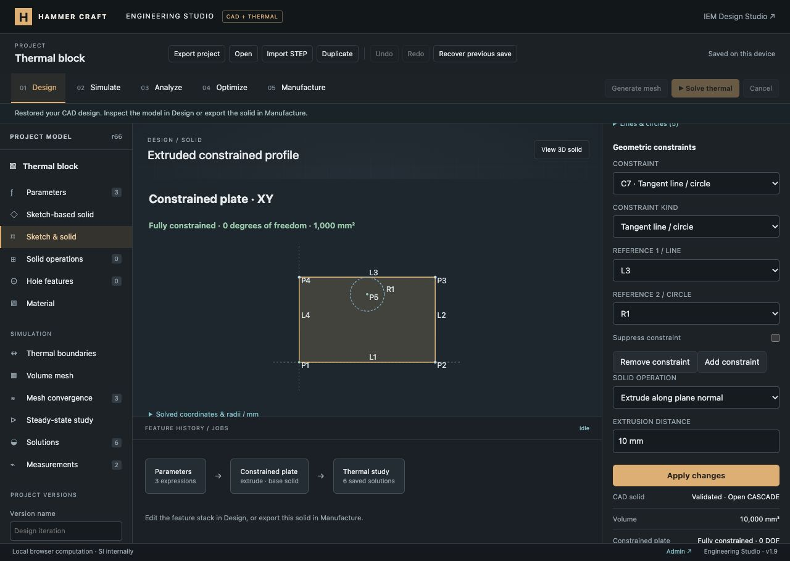

# Line and circle constraint verification

This milestone adds real geometric constraint solving to shared Engineering Studio sketches. The full platform remains in progress; the [requirement ledger](../../ENGINEERING_PROGRESS.md) tracks the outstanding scope.

## Implemented

- A stable graph of points, directed lines and circles; fixed coordinates, seed expressions, construction geometry and an explicit output loop. Existing rectangle/circle/ellipse/polygon coordinate profiles remain available.
- Eighteen geometric and dimensional constraint types: horizontal, vertical, parallel, perpendicular, coincident, concentric, equal length/radius, line/circle and circle/circle tangency, symmetry, distance, length, radius, diameter, directed angle and U/V coordinates. Rules support typed references, parameter expressions, suppression and removal.
- Pinned PlaneGCS 1.3.0 WebAssembly in separate preview and CAD workers. The established solver supplies actual degrees of freedom and conflicting/redundant IDs. Application postchecks independently verify residuals, finite geometry and valid closed profiles.
- Live fully/under/over-constrained status, labeled geometry and numerical solved coordinates/radii. Seed expressions remain editable source data; the solution does not overwrite them.
- Extrusion, revolution and downstream Boolean tools consume the solved profile. Invalid applied constraints clear the current solid and disable STEP/STL exports. Existing project history, local persistence and immutable thermal provenance remain supported.
- Constraint selection no longer marks geometry as edited. Applying a draft restored to its saved values now clears the stale edit indicator. The preview keeps a readable minimum height when the solved-coordinate table is expanded.

## Automated evidence

- Final `node --test tests/*.test.mjs`: **474 passed**, zero failures/skips/cancellations.
- `node --test tests/engineering*.test.mjs`: **131 passed**, including 17 new constraint tests.
- Runtime build, JavaScript syntax and `git diff --check` checks passed. The engineering GitHub workflow includes the new suite; remote CI has not run.

The new tests execute the real PlaneGCS WASM. Independent checks cover known rectangle/circle areas and solid volumes, free/fixed degrees of freedom, skewed seeds, parameter regeneration, all advertised constraint types, tangency distances, symmetry, conflicting and redundant IDs, suppression/recovery and deliberate residual violations. Validation tests reject invalid references, dimensions, duplicate IDs, excessive graph sizes and open/crossed/collapsed output loops. Integration checks cover constrained extrusion/revolution, downstream cuts, source history, project round trips, original thermal provenance, real STEP exchange and preview-worker recovery.

## Browser evidence

Verified in the existing loopback preview with its local authentication fixture. Production authentication remains unchanged.

- Created a 40 × 25 mm constrained rectangle with zero DOF, then extruded it 10 mm. Open CASCADE reported volume 10,000 mm³ and aluminum mass 27 g.
- Suppressed the height constraint and observed one free degree of freedom; restoring it returned zero DOF.
- Changed width constraint C5 to `length / 2`. Global length 60 mm produced area 750 mm² and volume 7,500 mm³. Changing length to 80 mm regenerated area 1,000 mm² and volume 10,000 mm³ without rewriting the expression.
- Added a redundant horizontal constraint and received its constraint ID. Applied incompatible lengths identified C5/C7, cleared the valid solid and disabled both STEP/STL exports in Manufacture. Removing the conflict restored the solid.
- Added fixed point P5 at (20,20) mm and construction circle R1 with a 4 mm seed radius. Tangency to the upper line solved R1 to radius **5 mm** with zero remaining DOF. The construction circle did not cut a hole or alter the rectangular solid volume.
- Saved a named version and reloaded. The graph, parameter expression, 4 mm seed radius and 5 mm solved radius persisted correctly. Pure constraint selection left the saved state unchanged.
- At 390 × 844, document width and scroll width both measured 390 px. Mobile suppression produced one free DOF; restoring and applying recovered the fully constrained profile and correctly showed “Saved on this device.” Reset the temporary viewport afterward.
- Existing Analyze results still displayed their original revision-31 thermal block with the outdated-input banner. The current constrained CAD body could not invoke the restricted thermal solver.
- Final browser warning/error logs were empty.

[Mobile constraint editor](mobile-constraints.jpg)

## Remaining limits

Constraints currently cover points, lines and circles. Arcs, elliptical constraints, splines, multiple output loops, snapping/projection and additional sketch editing tools remain unfinished. Each graph is limited to 64 points, 64 entities and 128 constraints. Nonlinear solutions follow the initial seeds; under-constrained profiles may generate solids but do not define unique geometry. There is no claim of global solution uniqueness.

The CAD model still produces one solid and has no assemblies or general volume meshing. Thermal studies remain restricted to an uncut homogeneous block. These changes are local; no Git commit/push or production deployment was performed.
