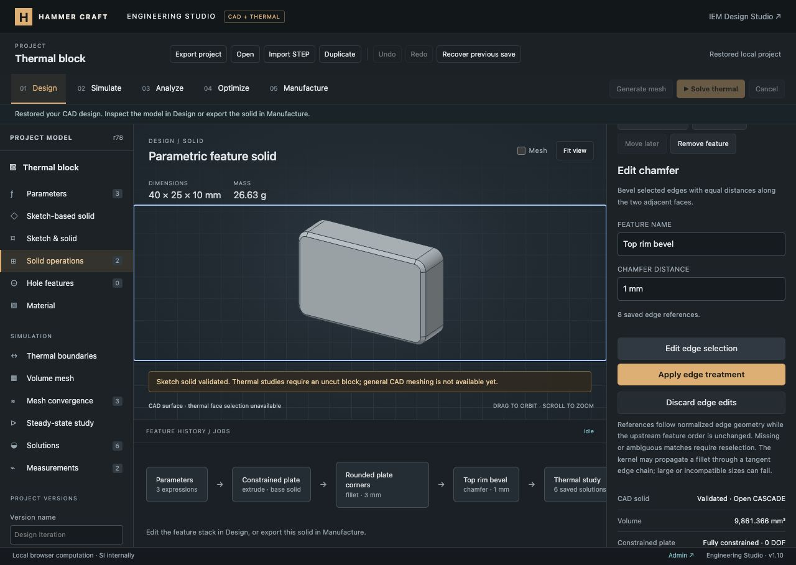

# Fillet, chamfer and edge-selection verification

This milestone adds real edge treatments to the shared CAD history. The full engineering platform remains in progress; see the [requirement ledger](../../ENGINEERING_PROGRESS.md).

## Implemented

- Constant-radius fillets and equal-distance chamfers through the pinned Open CASCADE/replicad runtime, operating on selected edges of blocks, profile solids, imported STEP and earlier feature results.
- Unit-aware radius/distance expressions, editable names, ordered history, suppression, removal, Undo/Redo and named versions. Each enabled stage must remain one valid closed solid.
- Input-edge catalogs with actual curve type, bounding-box center, length and display segments. Click visible edges in the viewport or use checkboxes; selected edges are highlighted. Screen picking checks triangle depth to reject hidden edges.
- Stable selection-reference IDs with normalized geometric anchors and ordered upstream support. Kernel indices are temporary display handles. Missing, ambiguous or changed-support references fail explicitly and support deliberate reselection.
- A separate worker reconstructs the input immediately before a selected feature, including when the finished model fails. Its view and mass are clearly labeled as the input; final export continues to require a valid complete history.
- Discard/cancel controls preserve the saved selection. Empty selections fail transactionally. Async completion of the main CAD build no longer discards an open input-edge selection.

## Automated evidence

- `node --test tests/*.test.mjs`: **489 passed**, zero failures/skips/cancellations.
- The 15 new edge-treatment tests also passed independently.
- JavaScript syntax and `git diff --check` checks passed. The GitHub engineering workflow includes the new tests; remote CI has not run.

Independent geometric checks include single and four-edge fillets/chamfers, a rounded cuboid's Minkowski-sum volume, an integrated rounded-rim chamfer volume, and circular-edge chamfers. Other cases cover parameter/translation regeneration, imported STEP modification, curve catalogs/lengths, true input-history reconstruction, ordered mixed operations, invalid units/IDs/references/limits, missing/ambiguous references, oversized failures and suppression recovery. Project/history tests preserve the original thermal provenance. Real STEP re-import and signed binary STL volumes validate exchange; the real CAD worker rejects stale export after a failed rebuild. Pure screen-picking cases check occlusion and bounded hit distance.

## Browser evidence

Verified in the existing loopback preview with its local authentication fixture. Production authentication remains unchanged.

1. Started from the persisted constrained 40 × 25 × 10 mm plate. Clicking a visible viewport edge selected its matching checkbox; the list also selected hidden edges.
2. Applied a 3 mm fillet to all four vertical corner edges. Kernel volume was **9,922.743 mm³**, matching `10000 − 4 × 10 × 3² × (1 − π/4)`.
3. Selected the eight top-rim edges on that result and applied a 1 mm chamfer. Volume became **9,861.366 mm³**, aluminum mass **26.63 g**. For perimeter `P = 2 × (40 + 25 − 12) + 6π`, removed volume is `P/2 − π/3`.
4. A 100 mm chamfer failed at its feature, cleared the finished preview and disabled STEP/STL exports. Input-edge inspection still reconstructed the valid preceding filleted plate. Restoring 1 mm recovered the final solid.
5. Moving the chamfer before the fillet reported changed upstream support. Input inspection showed 12 original-block edges and eight unresolved references, with explicit reselection controls. Starting a new selection and choosing a top edge repaired the chamfer; suppressing the now-invalid downstream fillet produced the independently expected **9,980 mm³** single-edge chamfered plate. Three Undo operations restored the original rounded-and-beveled history.
6. Clearing all selected edges was rejected without changing the accepted model. Discarding the draft restored its saved selection.
7. Saved **Rounded and beveled plate** as a named version. Reload retained both treatments, four/eight edge references, dimensions and final volume. The timeline displays each treatment and its dimension.
8. At 390 × 844, document width and scroll width both measured 390 px. Checkbox edits updated the highlighted selection and count; discarding restored all eight saved references. Reset the temporary viewport afterward.
9. The CAD body continues to reject the restricted block thermal study. Existing saved solutions remain present. Final browser warning/error logs were empty.

[Highlighted input edges](edge-selection.jpg) · [Mobile edge selection](mobile-edge-selection.jpg)

## Limits and remaining work

One solid, constant-radius fillets and equal-distance chamfers. Each treatment selects 1–64 edges; catalogs are limited to 512 edges and 150,000 preview line segments. Valid larger solids can still be viewed/exported without edge treatments. Kernel tangent-chain propagation may affect adjacent tangent edges.

Geometric remapping is deliberately limited to unique matches with unchanged upstream support. Some dimension changes preserve references; changes to normalized local geometry, feature order or upstream suppression require reselection. This does not implement complete topological naming or physics-face remapping. Variable-radius fillets, asymmetric/angle chamfers, other requested CAD operations, multiple bodies, assemblies and general volume meshing remain unfinished.

Changes are local. No Git commit/push or production deployment was performed.
