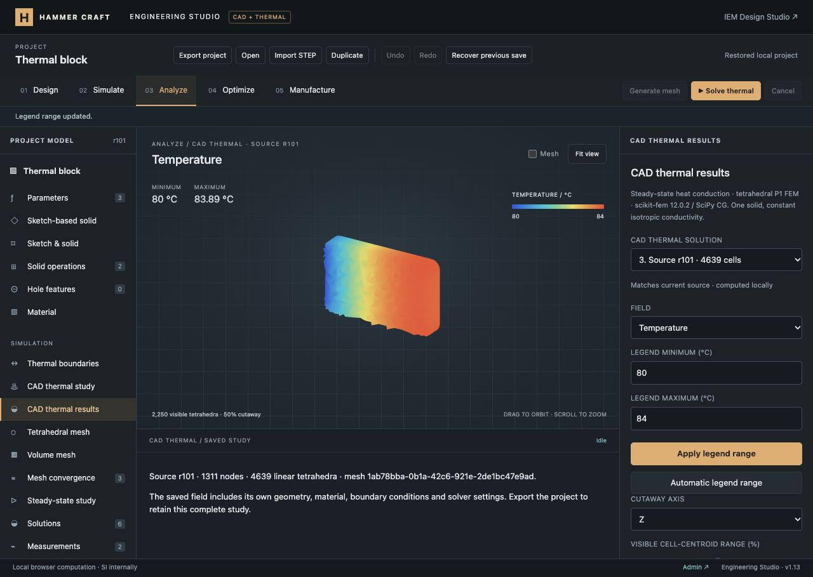

# CAD thermal FEM verification — 12 October 2026

Implemented and verified locally. This milestone adds a real field solver to the existing CAD tetrahedral meshes; it does not complete the full engineering-platform specification. No Git push or production deployment was performed.

## Implemented

- Executable built-in descriptors for the existing block FVM and new CAD thermal FEM, with study/physics/mesh compatibility checks and browser/local job transports. `runner.py` dispatches isolated mesh and thermal processes.
- One additional shared-model CAD thermal physics/study definition, with unit-aware fixed surface temperatures, convection/ambient conditions and uniform internal heat generation. Unassigned surfaces are insulated; constant isotropic conductivity is taken from the assigned material.
- Stable CAD surface-reference IDs with exact surface type/area/center descriptors and feature support. Mesh tags are resolved per snapshot. Remeshing unchanged geometry preserves references; changed CAD geometry requires explicit reselection. Ambiguous/missing references and touching surfaces with different prescribed temperatures fail explicitly.
- Real scikit-fem 12.0.2 P1 tetrahedral assembly with SciPy 1.18.1 Jacobi-preconditioned CG, temperature-increment solution, convergence and energy checks. Local jobs support cancellation, immutable input, process isolation and the existing 90-second cap.
- Separate temperature, gradient and flux fields on the actual mesh, including saved-source geometry, range controls, cutaways, source-staleness labels and numerical provenance. CSV exports every node/temperature; VTK exports the mesh, temperature and element-vector fields. Three complete FEM results are retained, independently of block results and mesh records.
- Compatible mesh reuse after material/thermal edits. History, versions, autosave, recovery, duplication and JSON validation retain existing workflows. Imported fields are marked unverified; imported meshes must be regenerated for a new solve.

## Automated verification

- `node --test tests/*.test.mjs`: **527 passed**, no failures/skips/cancellations. This includes all existing website, CAD and thermal tests and 12 new FEM tests.
- `python -m unittest discover -s tools/engineering-compute -p 'test_*.py'`: **16 passed**, comprising nine mesher/service checks and seven thermal benchmarks/validation checks.
- All **47** Engineering Studio JavaScript modules pass syntax checks; Python modules compile; `git diff --check` passes.
- New JavaScript tests cover registered methods, unit/reference errors, remeshing with changed tags, CAD/sizing guards, independent field validation, persistence/staleness, cutaway indexing, SI exports, HTTP execution and transport lifecycle. A serialization capacity test exercises 50,000 nodes and 100,000 cells without oversized argument-list failures.
- Thermal benchmarks cover exact linear block conduction and flux, fixed/convection series resistance, all-convection generation balance, heat-generation refinement toward the analytical parabola, isothermal curved geometry, and drilled-solid convergence toward axial conduction. The curved-wall mesh approximates the cylinder with triangles: increasing curvature resolution 12→24 reduces nodal RMS temperature error from approximately 0.00463 K to 0.00191 K. This explicitly measures geometric/discretization error rather than requiring an impossible exact field on faceted curved walls.

## Browser verification

Used the actual local preview and compute service, with the saved rounded/beveled constrained plate, 1,311 nodes, 4,639 tetrahedra and 18 CAD surfaces. The assigned illustrative material has constant conductivity 167 W/(m·K).

1. Created CAD thermal physics/study, selected surfaces from the list, and verified a viewport click selects the actual top surface (surface 8).
2. Applied 80°C to the X-min side (surface 7), convection of 100 W/(m²·K) to 20°C on the X-max side (surface 10), and 1e6 W/m³ internal generation. The 9.857 W heat source can raise the interior above the prescribed 80°C surface.
3. Solved with **120 CG iterations**. Temperature: **80–83.89273079°C**; volume mean: **82.76211488°C**. Equation backward error: approximately **1.907e-13**.
4. Energy accounting: generation **9.8568772801 W**, combined fixed-surface outward heat **8.7661158676 W**, convection outward heat **1.0907614126 W**, imbalance approximately **1.445e-11 W**.
5. Inspected temperature, heat-flux magnitude and gradient magnitude. Heat-flux range is approximately 85.66–99,804.58 W/m². X 50% cutaway displays 2,363 cells; Z 50% displays 2,250 cells. View controls leave the project revision unchanged.
6. Invalid reversed legend limits show a diagnostic; valid 80–84°C limits apply and clear the error. The field is shown on its saved mesh, never an unrelated old block plot.
7. Changing generation marks the earlier result outdated; Undo restores its current status. Starting/cancelling a job keeps prior fields. Source r96/r99/r101 fields survive reload; project r101 retains the new `CAD thermal plate` named version, prior CAD/material versions, both saved meshes, six block solutions and previous comparison records.
8. Exported CSV, VTK and project JSON through the UI. Every CSV coordinate/temperature matches its saved field. Gmsh independently reopened the VTK export with **1,311 nodes / 4,639 tetrahedra**. The exported project passed full source, mesh and field validation.
9. At 390×844, document width remains 390 pixels and field selection works. Temporary viewport overrides were reset. Final browser warning/error logs are empty.

[Mobile layout evidence](mobile-fields.jpg)

## Limits and next work

This is one-region, linear, steady conduction through the optional loopback compute service; the website has no deployed remote solver. Radiation, nonlinear/tensor conductivity, contact, transient heat transfer, multiregion/coupled physics and structural analysis remain unfinished. CAD FEM does not yet participate in the block-only sweep, measurement, probe or automated mesh-convergence workflows. CAD shape changes require surface reselection; general persistent topology remapping is still partial. The local process has a wall-time cap but no OS-level memory quota.

See [the workflow](../../ENGINEERING_STUDIO.md), [completion ledger](../../ENGINEERING_PROGRESS.md), [local compute setup](../../../tools/engineering-compute/README.md), [scikit-fem API](https://scikit-fem.readthedocs.io/en/stable/api.html) and [SciPy CG](https://docs.scipy.org/doc/scipy/reference/generated/scipy.sparse.linalg.cg.html).
