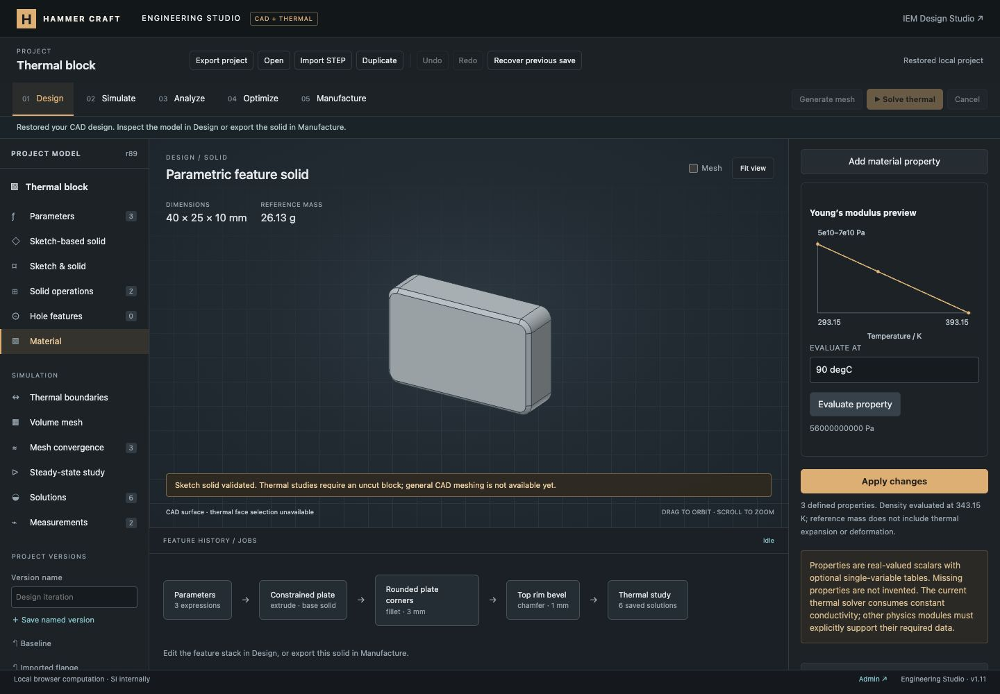

# Shared material library verification

This milestone adds unit-aware material properties and real interpolation curves to the shared project. The full engineering platform remains in progress; see the [requirement ledger](../../ENGINEERING_PROGRESS.md).

## Implemented

- A project library of up to 32 materials, with independent duplication, body assignment, editing, removal of unassigned entries, Undo/Redo and named versions.
- Nineteen scalar property definitions across general, mechanical, thermal, electrical, magnetic and acoustic/fluid domains. Missing optional values are not invented. Grade, source reference and notes travel with each material.
- Constants or 2–128-point, single-axis, piecewise-linear tables versus temperature, frequency, absolute pressure or strain. Both columns accept engineering units and global parameters. The B–H relation is a separate single-valued table versus H, with nondecreasing B; no hysteresis.
- Real SI interpolation plots and read-only evaluation probes; strict dimensional/range validation; explicit rejection or endpoint clamping outside the table range. Invalid drafts do not replace accepted source data.
- Variable density requires an explicit reference coordinate for mass. CAD and manufacturing label it reference mass; sweep objectives/constraints use each sample's reference density and CSV includes its axis, SI coordinate and clamping status. No thermal expansion or deformation is inferred.
- The current thermal solver explicitly rejects variable conductivity at the UI, mesher, solve, sweep, convergence and worker entry points. Optional properties do not activate unimplemented physics modules.
- Portable `hc-material-1` JSON snapshots resolve dependencies into SI expressions and import under a fresh ID. Project files retain original expressions, tables, reference conditions and metadata.
- Existing project serialization/result fingerprints and formerly valid parameter names such as `T`, `S` and `bar` remain compatible. Parameters take precedence over the newly introduced material-unit aliases when their names collide.

## Automated evidence

- `node --test tests/*.test.mjs`: **504 passed**, zero failures, skips or cancellations.
- **15 material tests**, covering the new schema, independent interpolation and reference-mass calculations, units, all input axes, B–H monotonicity, bad inputs and size limits, solver restrictions, real worker failure responses, unchanged constant-conductivity fields, history/provenance, portable snapshots and reference-condition sweeps.
- The focused material/sweep run passed; 38 engineering modules passed JavaScript syntax checks. `git diff --check` passed.
- The GitHub engineering workflow includes the material tests. Remote CI has not run.

The numerical examples below are deliberately synthetic software-verification data. They are not certified properties of aluminum or any other grade.

## Browser evidence

Verified in the existing loopback preview using its local authentication fixture. Production authentication remains unchanged.

1. Duplicated the illustrative aluminum entry, supplied source notes and named the copy **Material curves · synthetic demo**. The original stayed unchanged. Assignment was a separate action.
2. Entered density 2,700 kg/m³ at 20 °C and 2,600 kg/m³ at 120 °C, with an explicit 70 °C reference. The probe returned **2,650 kg/m³**. The existing rounded/beveled plate retained its **9,861.366 mm³** volume and displayed **26.13 g reference mass**.
3. Added Young's modulus at three nonuniform knots: 70 GPa at 20 °C, 62 GPa at 60 °C and 50 GPa at 120 °C. The probe returned **56 GPa at 90 °C** and **66 GPa at 40 °C**. The graph displays those actual SI points and linear segments.
4. A 200 °C probe returned the configured extrapolation error. Reversing the curve rows and applying returned an increasing-coordinate diagnostic; revision 82 and the accepted material stayed unchanged. Restoring the accepted rows was a no-op.
5. Exported a portable material JSON and imported it through the file picker. The imported curve used SI values and was independently selectable without changing body assignment. Removal, Undo and Redo worked.
6. Saved **Material library curves** as a named version. On a temporary uncut block, changed conductivity to a temperature curve. Simulate displayed **Study requires constant conductivity**, with mesh/solve disabled; mesh-check and Optimize setup also displayed the restriction. Previously saved comparisons stayed accessible.
7. Restored the named plate version, then reloaded after autosave. The accepted project is revision **89**, with four library materials, the original sketch/fillet/chamfer geometry, the assigned synthetic material, and all earlier saved solutions, checks and measurements retained. Conductivity remains the original constant 167 W/(m·K).
8. At **390 × 844**, both document width and scroll width measured **390 px**. The material graph and evaluation controls remained usable. Probe changes did not create an unapplied source draft or advance the project revision.
9. Saved desktop and mobile screenshots, restored the temporary viewport and left the Engineering Studio tab available. Final warning/error logs were empty.

[Mobile curve evaluation](mobile-material-curve.jpg) · [Thermal compatibility check](thermal-compatibility.jpg)

## Limits

This is scalar property storage, validation and interpolation plus explicit reference-density use. It is not a material certification database or a constitutive solver. Tensors, complex quantities, multiple independent variables, hysteresis, plasticity, viscoelastic models and body/region-specific assignments remain unfinished. Mechanical, electrical, magnetic, acoustic and coupled field solvers are still missing. The existing thermal solver remains restricted to constant isotropic conductivity on the supported uncut block.

Changes are local; no Git commit, push or production deployment was performed.
