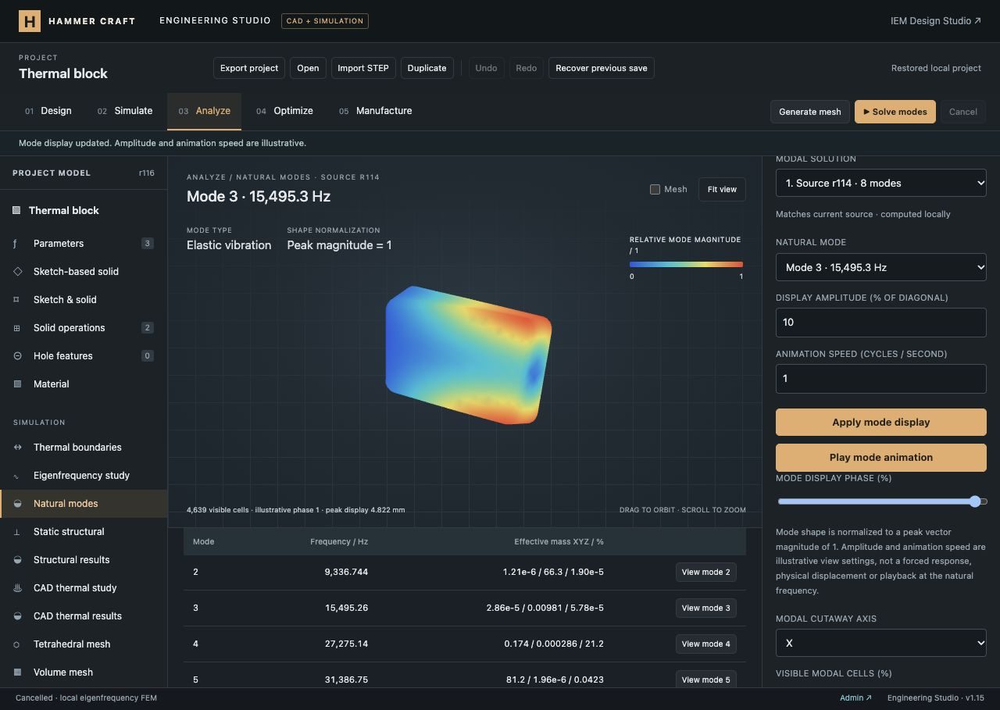
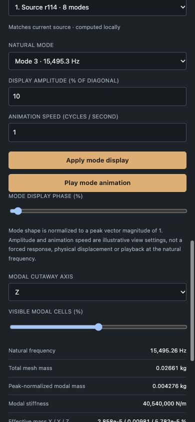

# Eigenfrequency and mode-shape verification — 2026-10-12

Engineering Studio now computes undamped, unprestressed natural modes on the shared CAD tetrahedral mesh. The original platform remains [in progress](../../ENGINEERING_PROGRESS.md); harmonic response, damping and mechanical impedance are not yet implemented. No commit, push or production deployment was performed.

## Delivered behavior

- Independent modal surface restraints on the shared source: fixed XYZ or selected zero-displacement components, plus free-body support. Constant E, ν and density are required. Static loads/gravity are not applied to the eigenproblem.
- Shared vector-P1 elastic stiffness, consistent mass and SciPy shift-invert eigensolve. Requested 1–12 modes include rigid modes. Six free-body modes remain zero-frequency without artificial stiffness.
- Natural frequencies, normalized nodal shapes, modal mass/stiffness, global translational participation/effective mass and residual/orthogonality diagnostics.
- Actual-mesh display, signed phase, whole-cell cutaways, explicit illustrative amplitude/speed, play/pause and fixed full-cycle camera bounds. Navigation and page hiding stop animation.
- Three immutable mode sets with their own source/mesh, history, named versions, staleness, autosave, project import/export and SI CSV/VTK. Imported results are unverified.

## Numerical verification

**545 JavaScript tests passed**, zero failures/skips, with `node --test tests/*.test.mjs` (38.9 seconds). **30 Python tests passed** with the pinned environment and `python -m unittest discover -s tools/engineering-compute -p 'test_*.py'` (3.4 seconds). This includes nine new modal JavaScript tests and six modal Python tests, plus prior static/thermal/geometry/site regression coverage. CI includes the new suite.

The modal tests compare sparse eigenvalues with SciPy’s dense generalized symmetric eigensolve, using a separately assembled exact tetrahedral consistent mass matrix. They verify frequency scaling as √E and 1/√ρ; canonical peak normalization; six free-body rigid modes and their translational effective-mass completeness; three residual rigid modes with an X-only surface restraint; and invalid load, displacement, material, count and size rejection.

For a 60 × 20 × 10 mm bar with E = 70 GPa, density 2,700 kg/m³ and ν = 0, the axial continuum fundamental is `sqrt(E/rho)/(4L) = 21,215.628217 Hz`. Axial displacement is fixed at X-min; lateral displacement is zero on boundary surfaces. The numerical axial mode converges from above:

| Maximum size | Nodes | Tetrahedra | Fundamental |
| --- | ---: | ---: | ---: |
| 8 mm | 106 | 246 | 21,239.366951 Hz |
| 4 mm | 365 | 1,073 | 21,223.134447 Hz |

This axial benchmark verifies the stated case. It does not establish mesh independence for bending, near-incompressibility or arbitrary geometry. The previous static cantilever refinement benchmark demonstrates coarse linear-tetrahedral stiffness.

Frontend validation independently integrates element stiffness/mass, checks free-DOF eigen-equations and Rayleigh quotients, verifies homogeneous constraints, peak normalization, mode ordering, frequencies, rigid-mode count, modal mass/stiffness, participation and pairwise mass orthogonality. Corrupt fields/metadata are rejected. Tests also cover history/import/retention, unchanged saved fields during animation, phase limits and fixed bounds, animation throttling/stopping, SI exports and actual HTTP solve dispatch.

## Browser case

The rounded/chamfered 40 × 25 × 10 mm plate uses 1,311 nodes and 4,639 tetrahedra. Material **Structural aluminum · synthetic demo** has E = 70 GPa, ν = 0.33 and density = 2,700 kg/m³. Total mesh mass is 0.0266135686564 kg. Modal surface 7 (X-min) is fixed; all others are free. The existing static study’s loads remain separate.

Source revision 114 produced eight positive frequencies:

| Mode | Frequency / Hz |
| --- | ---: |
| 1 | 5,320.130230 |
| 2 | 9,336.744107 |
| 3 | 15,495.255380 |
| 4 | 27,275.137882 |
| 5 | 31,386.749272 |
| 6 | 35,046.763287 |
| 7 | 46,689.735485 |
| 8 | 62,331.941489 |

Removing the restraint and solving source revision 115 produced six zero-frequency rigid modes, followed by 29,903.552845 and 31,476.181015 Hz. Rigid modes are labeled as motion without restoring force and their elastic-oscillation Play control is disabled. The complete retained numerical summaries are in [numerical-evidence.json](numerical-evidence.json).

Browser checks covered study creation, restraint assignment, both solves, changing modes through the selector and table, animation with changing positive/negative phase, pause, display amplitude, manual phase, Z 50% cutaway (2,250 cells), named version **Natural modes plate**, Undo, stale labeling, retained fields after cancellation, reload, and stopping animation on navigation to structural results. Undo left current revision 116 matching the restrained revision-114 source; the free-body result remains inspectable and outdated.

The downloaded modal CSV and selected mode-3 VTK exactly match the validated project result. Gmsh reopened that VTK with all 1,311 nodes and 4,639 tetrahedra. The exported project validates both mode sets and prior thermal/structural results.

Desktop evidence uses the default 1280 × 720 viewport with a 1280 × 909 full-page screenshot. Mobile QA at 390 × 844 verified phase/cutaway controls and a document width/scroll width of 390 pixels. The temporary viewport was reset; final browser logs contained no warnings/errors.

## Numerical and deployment limits

One connected isotropic solid; constant material properties; linear tetrahedra; no damping, prestress/geometric stiffness, contact, forced/harmonic response, impedance or transient response. Eigenvectors have arbitrary amplitude: the displayed 10% diagonal amplitude and 1 cycle/second playback are view settings, not physical displacement or an actual oscillation at 15.495 kHz. Closely spaced/repeated eigenspaces can rotate between discretizations.

The modal cap is 10,000 nodes / 40,000 tetrahedra / 12 modes. The loopback service retains the 90-second watchdog, 32 MiB output cap and no OS memory quota. A failed or partially converged eigensolve does not save a partial mode set. Sparse factorization and frontend validation costs remain practical limits for larger models. This is local compute; no public production backend was deployed.
