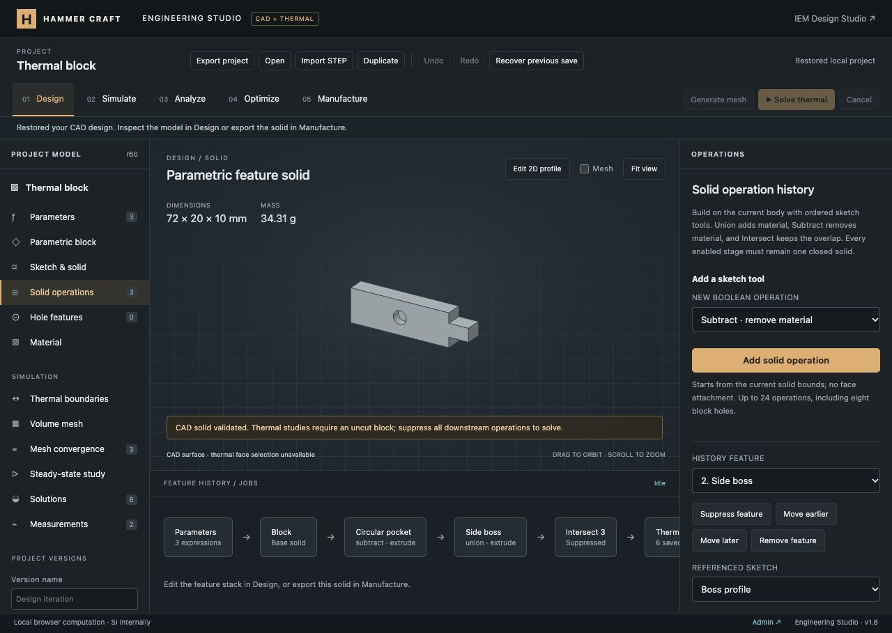

# Ordered Boolean feature history verification

This milestone adds editable sketch-tool union, subtraction and intersection to the shared Engineering Studio project. The full platform remains in progress; the [requirement ledger](../../ENGINEERING_PROGRESS.md) retains the outstanding scope.

## Implemented

- Block, sketch-based or embedded single-solid STEP bases support up to 24 ordered downstream features, including at most eight legacy block holes.
- Extruded or revolved rectangle/circle/ellipse/polygon profiles provide the Boolean tools. Their dimensions, origins and operation parameters accept the existing unit-aware expressions.
- Feature selection, suppression/enabling, reordering and removal; shared profile references and independent sketch copies; Undo/Redo, versions, autosave and project round trips.
- Actual Open CASCADE Boolean operations, with topology and positive single-solid validation at every enabled intermediate stage. Failed geometry clears the current preview and blocks exports; later operations cannot hide a failed stage.
- Final kernel bounds, volume and material-derived mass. Legacy cylinder cuts remain in the same ordered stack and retain their original block extents.
- Active operations remain incompatible with the restricted block thermal solver. Existing solution provenance remains unchanged.

## Automated evidence

- `node --test tests/*.test.mjs`: **457 passed**, zero failures/skips/cancellations.
- After final kernel diagnostic changes, `node --test tests/engineering*.test.mjs`: **114 passed**, including 13 new operation tests.
- JavaScript syntax and `git diff --check` checks passed. The GitHub workflow includes the operation suite; remote CI has not run.

Independent geometric checks cover overlapping box union/subtract/intersection volumes and bounds, through cuts, parameter-driven blind pockets, boss additions, the different results of cut-then-refill versus refill-then-cut, revolved cutters and edits to imported STEP bases. Reference tests cover shared-profile edits, detachment, removal/pruning, suppressed references, missing/foreign/duplicate IDs, unsupported operations, dimensions and limits, legacy geometry keys and source history.

Empty, split and disconnected intermediate shapes must fail at their responsible feature even when a later union would restore a solid. The real CAD worker is tested through successful build, failed rebuild, rejected stale export and recovery. STEP re-import preserves the mixed-operation volume; binary STL has outward signed volume within tessellation tolerance. Thermal tests retain the original saved inputs, reject active tools, and reproduce the original field after all downstream operations are suppressed.

## Browser evidence

Verified in the existing loopback preview with its local authentication fixture. Production authentication remains unchanged.

- Preserved the previous revolved model as a named version, then created a 60 × 20 × 10 mm block.
- Added the default circular subtraction: radius 4 mm, full-height cut. Measured volume was 11,497.35 mm³, matching `12000 − 160π`.
- Changed the tool origin Z to `height` and distance to `-height/2`, producing a blind pocket of volume 11,748.67 mm³, matching `12000 − 80π`.
- Added a rectangular side boss. Final bounds became 72 × 20 × 10 mm, volume 12,708.67 mm³ and aluminum mass 34.31 g. Bounds no longer incorrectly remain the base dimensions.
- Moved the boss away from the body. The CAD failure appeared, the solid preview was cleared, and both STEP/STL exports were disabled. Suppression restored the pocketed block; editing and enabling restored the boss.
- Reordered the boss, removed it and undid removal. Added an intersection that clipped the leftmost 18 mm; volume became 9,108.673 mm³.
- Reused the boss sketch for the intersection, verified the shared-sketch warning/consumer names, made it independent, and changed its width to 12 mm. The resulting clipped solid was 12 × 8 × 10 mm with volume 960 mm³. Undo restored the original intersection, which was then suppressed.
- Saved the pocket/boss stack as a named version. Existing Analyze results continued to show their original revision-31 thermal block with the outdated-input banner.
- Added and edited a legacy hole after the sketch features. A 5 mm bore through the pocket floor gave 12,610.5 mm³; changing it to 3 mm gave 12,673.33 mm³. All sketch features and their order remained intact. Removing that hole restored 12,708.67 mm³.
- Reload retained the three-operation history, suppressed intersection, parameter expressions and named versions. The new Add control appears above the editor so adding another feature does not require scrolling through all profile fields.
- Checked the 390 × 844 layout and selected a feature using its mobile controls. Document width and scroll width both measured 390 px. Reset the temporary viewport override afterward.
- Final browser warning/error logs were empty.

[Mobile layout evidence](mobile-history.jpg)

## Remaining limits

One resulting body at every enabled stage; there are no independent body/component operands or assemblies. Each sketch has one closed profile. General constraint solving, face attachments/remapping, fillets/chamfers and other feature types remain unfinished. Imported STEP can receive sketch-tool operations but has no direct face editing or recovered source feature history. Thermal simulation remains limited to the uncut base block; arbitrary CAD is not approximated as a box.

Changes are local. No Git commit/push or production deployment was performed.
