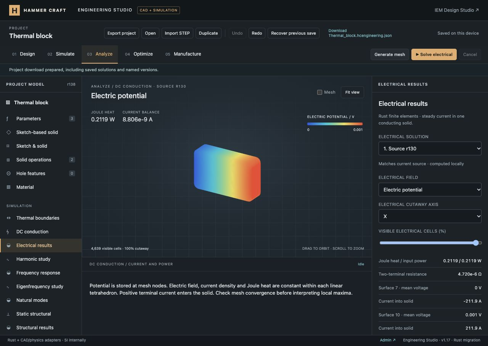

# Rust foundation and DC conduction verification

Engineering Studio migration milestone, implemented/tested on 12 October 2026; report completed during continuation on 15 October. This is a partial platform and Rust migration. The live source has subsequently gained native Rust structural solving; see the [later migration report](../2026-10-15-engineering-rust-structural/README.md) for that change.

## Implemented at this milestone

- Rust workspace with shared native/WebAssembly core, locked dependencies and build script.
- Rust SI expression engine and parameter editor integrated into existing project/CAD workflows.
- Rust block thermal FVM and native CAD thermal P1 FEM; prior Python result metadata remains valid.
- Rust Axum/Tokio local compute supervisor with bounded jobs, cancellation, timeout and explicit foreign-library adapters.
- Native Rust DC conduction with voltage/current terminals, current/power balance, potential/E/J/Joule fields, cutaways and CSV/VTK exports.
- Saved electrical source/mesh provenance, stale detection, Undo, named versions, reload and import validation.
- Fixed asynchronous WASM worker startup and Rust browser diagnostic conversion found in browser testing.

## Verification

Full repository run: **566 JavaScript tests passed**, zero failures/skips (40.94 s). An additional adapter-dispatch test was added afterward; the complete Rust-focused suite then passed **12/12**, including actual Gmsh, static, modal and harmonic dispatch. **36 Python tests** and **8 native Rust tests** passed. Rustfmt and Clippy with warnings as errors passed. CI builds native/WASM code before checking the browser integration.

Independent thermal references cover fixed temperatures, convection, generation and all-Robin cooling. Native Rust temperatures differed from the existing scikit-fem/SciPy reference by at most 8×10⁻¹¹ K in the sampled benchmarks. Electrical uniform-bar tests check R=L/(σA), voltage/current excitation, gauge offsets, scaling, zero excitation, malformed meshes, terminal conflicts, independent nodal integration and native/WASM equality.

## Browser evidence

The saved rounded/chamfered 40 × 25 × 10 mm CAD plate uses 1,311 nodes and 4,639 tetrahedra. Illustrative conductivity is 3.5×10⁷ S/m; it is synthetic demonstration material data.

| Excitation | Computed response |
| --- | --- |
| Surface 7 = 0 V; surface 10 = 1 mV | ±211.9 A terminal current; 4.720 µΩ two-terminal resistance; 0.2119 W Joule heat |
| Surface 7 = 0 V; uniform total current +1 A on surface 10 | 4.769 µV area-weighted terminal voltage; 4.769 µW Joule heat |

Uniform current and equipotential voltage boundary conditions are different physical constraints; their effective resistances need not coincide for this curved geometry. Current imbalances were 8.806×10⁻⁹ A and 2.773×10⁻¹² A respectively. The 1 mV power imbalance was approximately −4.16×10⁻¹⁶ W.

Verified Rust parameter add/remove/apply, incompatible-unit feedback, pending-edit auto-apply, CAD regeneration, block thermal solve, voltage/current electrical solves, field selection, 50% Z cutaway (2,250 cells), stale detection and Undo, named version, reload, CSV/VTK download and full project export. The exported 29.75 MB project validated with both electrical solutions and 14 named versions; import marks numerical results unverified. CSV contains 1,311 node rows plus header. At 390 px the document width stayed 390 px with no horizontal overflow; the temporary viewport was reset.

Exact browser summaries: [browser-results.json](browser-results.json).

[Mobile layout evidence](electrical-mobile.png).

## Not completed

Most UI/project/rendering code remains JavaScript. CAD/constraints are C++/WASM; at this milestone Gmsh and mechanics used Python/native adapters. Modal/harmonic migration, multi-body CAD/assemblies, additional physics, circuits, coupled/transient/nonlinear analyses, broader meshing/optimization, manufacturing and production infrastructure remain open. No commit, push or production deployment was performed. See [coverage ledger](../../ENGINEERING_PROGRESS.md) and [Rust build/migration documentation](../../../engineering-rust/README.md).
