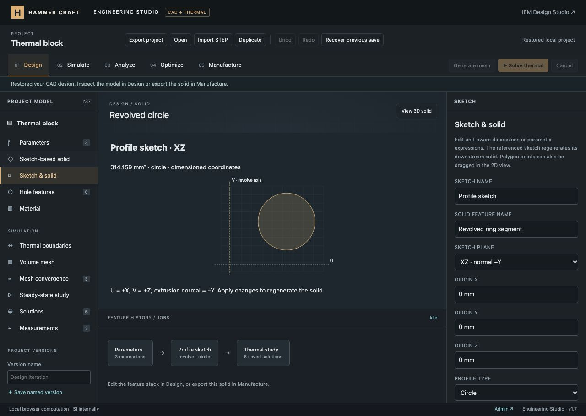
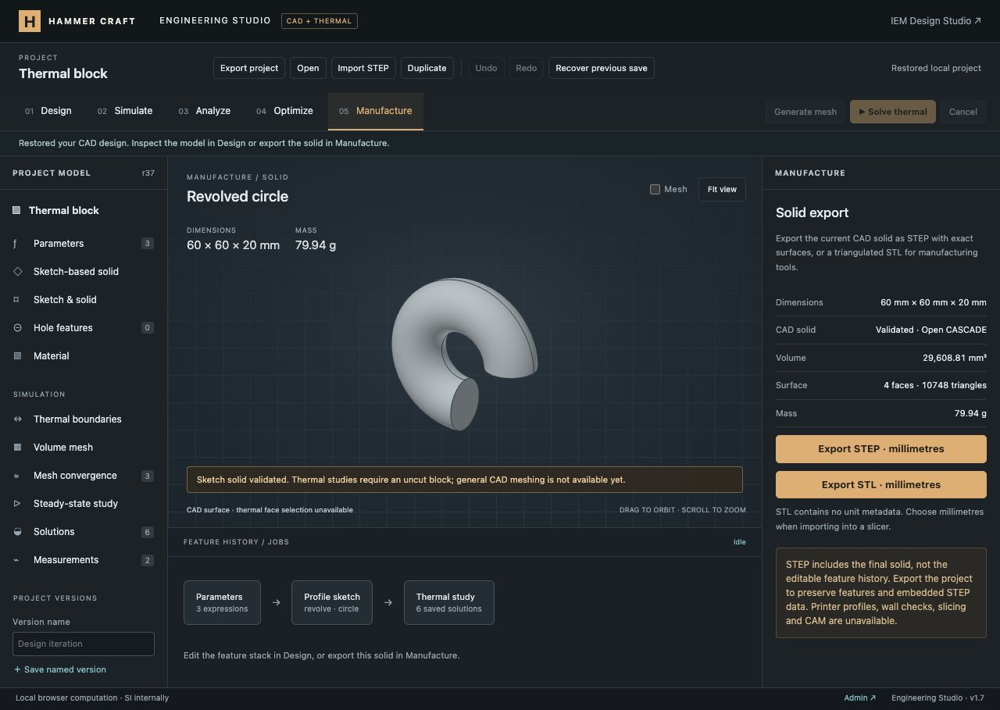

# Sketch extrusion and revolution verification

This milestone adds a dimensioned profile editor and exact sketch-based solids to the existing shared engineering project. It does not complete the full platform. [Remaining requirements](../../ENGINEERING_PROGRESS.md) preserve the original scope.

## Implemented

- Separate sketch source with stable ID, named plane, XYZ origin and rectangle/circle/ellipse/polygon profile.
- Global parameter expressions in coordinates, dimensions, extrusion distance and revolution angle; dimensional validation and transactional source edits.
- Three right-handed plane frames, negative/positive extrusion, partial/full revolution about the local V axis.
- Editable polygon point fields and explicit 0.5 mm snapped dragging in the 2D preview, plus a switch to the generated 3D solid.
- Real pinned Open CASCADE construction, single-solid/topology validation, kernel volume/mass, STEP/STL exports, project persistence and original-result provenance.
- Rebuilt the pinned replicad adapter with its drawing/plane exports and refreshed the vendor integrity manifest. No new dependency versions or remote runtime services.

## Automated evidence

- `node --test tests/engineering*.test.mjs`: **101 passed**, including 13 new sketch tests.
- `node --test tests/*.test.mjs`: **444 passed**, zero failures/skips/cancellations.
- `git diff --check` and JavaScript syntax checks passed.
- Workflow includes the new test file; remote CI has not run.

The new geometry tests independently check rectangle, circle, ellipse and concave polygon extrusion volumes on XY/XZ/YZ; translated origins, negative directions and global bounds; cylinder/torus volumes for 90°, 270° and 360° revolutions on every plane; area-first-moment volume for a concave revolved profile; clockwise input; ellipse orientation when its V radius is larger; and parameter-driven regeneration. STEP re-import preserves a partial torus volume; binary STL has positive outward signed volume within tessellation tolerance. A real module worker builds/exports a sketch solid and rejects a stale export fingerprint.

Validation tests reject unit mismatches, missing/duplicate sketch references, invalid operation ranges, unsupported profiles, crossing/touching/degenerate polygons, point limits, axis crossings and pinched curved revolutions. Source/history tests retain old thermal fields unchanged, mark them outdated, round-trip sketch expressions and named versions, and preserve canonical serialization for existing fixed-temperature block projects.

## Browser evidence

Verified with the loopback preview and its existing local authentication fixture; production authentication remains unchanged.

- Created the default L profile and a 10 mm extrusion. Kernel volume was 7,000 mm³ (18.9 g at 2700 kg/m³).
- Dragged point 5 to (19.5, 31.5) mm. The draft showed 756.25 mm²; Apply regenerated a 7,562.5 mm³ solid. The 3D switch displayed the modified bracket.
- Repeated a polygon point by setting point 2 U to zero; Apply rejected the edit and retained the accepted solid and revision. Restoring it to `length * 2 / 3` accepted the parameter expression.
- Saved the bracket as a named version and reloaded the project. Point coordinates, sketch reference, operation and measured solid were retained.
- Switched to a circle (center U=20 mm, V=15 mm, radius 10 mm), XZ plane and 270° revolution. The generated ring segment had volume 29,608.81 mm³ and mass 79.94 g, matching the independent torus-volume calculation.
- Existing saved thermal results remained viewable with their original block geometry and outdated-input banner. Thermal meshing/solving stayed disabled for the sketch solid.
- Manufacture prepared a STEP Blob download link. File contents and re-import are verified by automated tests; actual download delivery was not confirmed in the in-app browser.
- Duplicate preserved the sketch solid and measurements while clearing results/checks. Recovery restored the working project, including six solutions, three mesh checks and named versions. Reload again retained the revolved solid.
- Checked the 390×844 profile editor and inspected the desktop profile/solid views. Mobile document width and scroll width both measured 390 px. The viewport override was reset.
- No warning/error browser logs were reported in the final checked flows.

## Current limits

One closed profile and one extrusion/revolution. This is a coordinate/dimension editor, not a geometric constraint solver. General line/arc/spline entities, multiple loops, geometric constraints, downstream sketch features, assemblies and arbitrary Boolean editing remain unfinished. Through-holes still require the original block. Simulation on sketch solids requires a general CAD volume mesher and solver integration; these shapes are not approximated as thermal boxes.

Changes are local; no Git commit/push or production deployment was performed.
