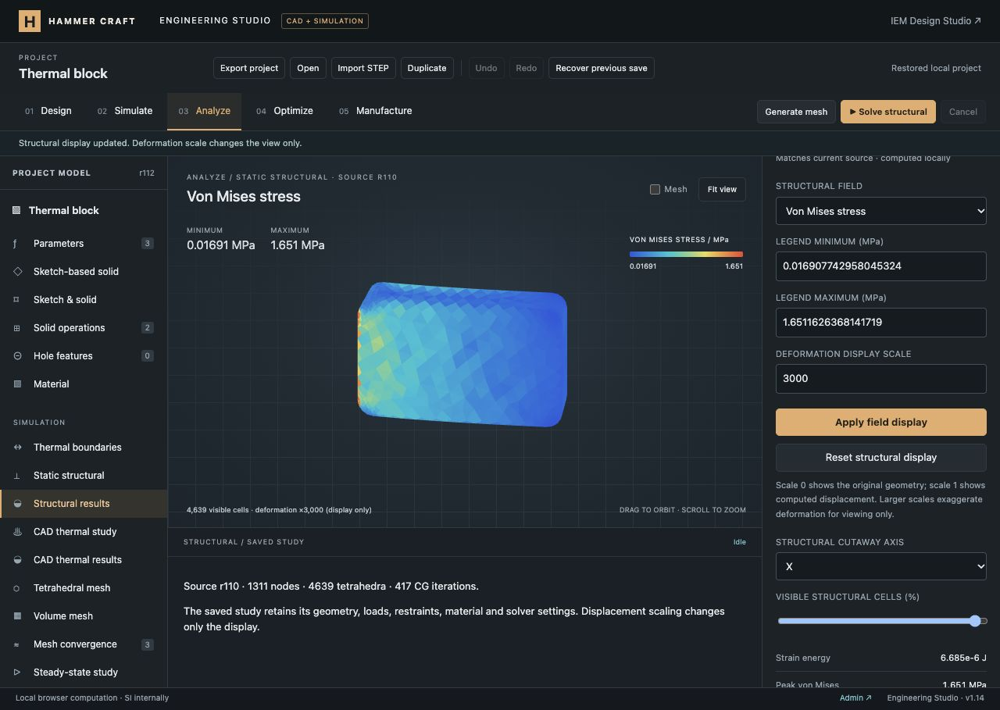
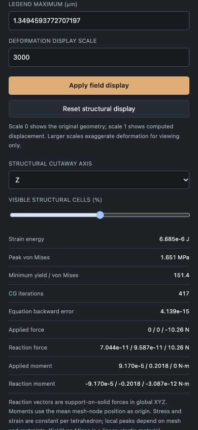

# Static structural FEM verification — 2026-10-12

The Engineering Studio now solves small-strain isotropic static elasticity on the actual CAD tetrahedral mesh through the local scikit-fem/SciPy service. This is a verified subset of the requested platform; [the completion ledger](../../ENGINEERING_PROGRESS.md) remains in progress. No production deploy, commit or push was performed.

## Delivered behavior

- Shared source study, material assignment, geometric CAD face references, fixed/partial prescribed displacement, distributed total surface force, inward-positive pressure and global gravity.
- Pinned vector P1 elasticity with explicit rigid-body restraint checking, constraint conflicts, convergence failure, applied/reaction force and moment accounting. No artificial support springs.
- Displacement, strain, stress, principal stress, von Mises, strain energy and optional yield/von-Mises comparison. Display-only deformation, custom legends, actual-cell cutaways and SI CSV/VTK exports.
- Three retained immutable structural results with their own mesh and source, staleness detection, history/versions, autosave and portable import/export. Imported results are unverified.
- Shared `fem_mesh.py` validation for thermal and structural solvers; registered process dispatch and cancellation preserve completed results.

## Automated evidence

`node --test tests/*.test.mjs`: **536 passed, zero failures/skips** (38.8 seconds). This includes existing website/IEM/CAD/thermal regressions and nine new structural integration tests.

`OPENBLAS_NUM_THREADS=1 tools/engineering-compute/.venv/bin/python -m unittest discover -s tools/engineering-compute -p 'test_*.py'`: **24 passed** (2.8 seconds), including eight structural tests and the existing mesh/thermal tests. CI includes the new JavaScript suite and discovers all Python tests.

Syntax checks passed for 64 engineering source/test JavaScript modules; all compute Python modules compiled. `git diff --check` passed. Browser logs contained no warnings/errors during final QA.

Exact tests cover a 60 × 20 × 10 mm bar, E = 70 GPa and ν = 0.3, with roller constraints and 100 N axial force. They check the full displacement field including Poisson contraction, 500 kPa axial/von-Mises stress, reactions and strain energy. Additional tests cover positive-pressure compression, prescribed 1 µm extension, gravity/moment balance, zero load, bad material/vector inputs, insufficient restraints and incompatible shared-node constraints. Frontend tests reconstruct tensors independently and reject corrupted fields, energy, principal invariants, reactions and provenance; an actual HTTP subprocess solve is validated.

For the same bar clamped at X-min with a uniformly distributed −10 N Z-force at X-max, the work-conjugate mean tip deflection is `2U/F`:

| Maximum mesh size | Nodes | Tetrahedra | Mean tip deflection |
| --- | ---: | ---: | ---: |
| 8 mm | 106 | 246 | 2.183454 µm |
| 4 mm | 365 | 1,073 | 3.988685 µm |
| 2 mm | 1,882 | 7,601 | 5.421642 µm |

Euler–Bernoulli bending plus a 5/6 shear correction gives an approximate 6.305143 µm reference. This is not an exact 3D clamped-solid solution. The benchmark deliberately demonstrates the substantial stiffness of coarse linear tetrahedra and improving deflection under refinement; it does not certify a mesh-independent engineering design.

## Browser evidence

The existing rounded and chamfered 40 × 25 × 10 mm plate reused its 1,311-node / 4,639-tetrahedron mesh. A duplicate material named **Structural aluminum · synthetic demo** was assigned with constant E = 70 GPa, ν = 0.33, density = 2,700 kg/m³ and illustrative yield strength = 250 MPa. The earlier material and CAD thermal source snapshots remain preserved.

Surface 7 (X-min) is fixed; surface 10 (X-max) carries (0, 0, −10) N. Gravity is (0, 0, −9.81) m/s². The computed source is revision 110. Results:

| Quantity | Value |
| --- | ---: |
| Peak displacement magnitude | 1.349459377 µm |
| Peak von Mises stress | 1.651162637 MPa |
| Strain energy | 6.684862352 × 10⁻⁶ J |
| CG iterations | 417 |
| Free-equation backward error | 4.13923 × 10⁻¹⁵ |
| Applied Z force | −10.261079109 N |
| Reaction Z force | +10.261079109 N |
| Applied Y moment | +0.2017535923 N·m |
| Reaction Y moment | −0.2017535923 N·m |

The moment origin is the mean mesh-node position. The strength ratio uses the explicitly illustrative material and is not a general safety certification.

Verified in the actual browser: material copy/edit/assignment; study creation; face selection by selector; force and gravity expressions; local solve; displacement/stress field switching; deformation ×3,000; Z 50% whole-cell cutaway (2,250 visible cells); named version **Structural plate**; CSV/VTK/project downloads; insufficient-support rejection; outdated result labeling; Undo restoring matching source; cancellation retaining the prior result; and reload persistence. Undo left the project at revision 112 with source matching the saved revision-110 solution.

Exported CSV and VTK match their independently regenerated saved fields exactly. Gmsh reopened the exported VTK and recovered all 1,311 nodes and 4,639 tetrahedra. The exported project validates with the complete structural solution and existing result collections.

Desktop QA used the default 1280 × 720 viewport (full-page evidence 1280 × 909). Mobile QA used 390 × 844, verified field/cutaway controls and accounting, and found no horizontal document/control overflow. The viewport override was reset after testing.

## Limits and remaining work

One connected solid, constant isotropic small-strain elasticity, first-order tetrahedra and static loads only. Contact, plasticity, springs/bearings, dedicated torque loads, thermal expansion, multiple regions, dynamics, structural sweeps and automated structural convergence are not implemented. Coarse bending meshes and near-incompressibility require special care; geometry changes require explicit surface reselection.

The optional loopback service is needed for new FEM solves. It retains the 90-second watchdog and 32 MiB output cap; these can limit structural jobs before the 50,000-node / 100,000-tetrahedron mesh caps. There is no OS memory quota or production remote-compute deployment. Saved fields remain inspectable without a running service.
