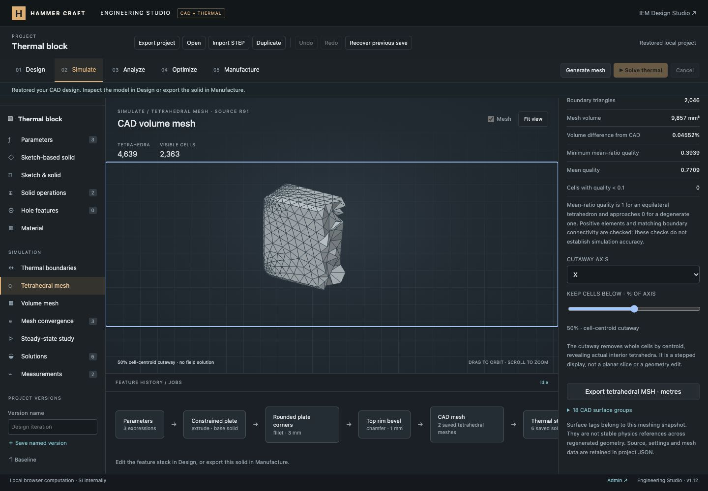

# General CAD volume-mesh verification

This milestone connects exact CAD snapshots to real Gmsh tetrahedral meshing. The full engineering platform remains in progress; see the [requirement ledger](../../ENGINEERING_PROGRESS.md).

## Implemented

- An optional loopback compute service using pinned Gmsh 4.15.2 and NumPy 2.4.4. Each job runs in an isolated subprocess with cancellation, a 90-second watchdog, one active job and bounded temporary retention. The service accepts only STEP and validated numerical sizing settings, not executable scripts.
- A `gmsh-tetra` definition in the shared source's mesh collection alongside the existing structured thermal grid. Five sizing presets, unit-aware minimum/maximum size expressions and curvature resolution are editable and versioned.
- Exact final CAD STEP snapshots from the existing Open CASCADE worker, including downstream features. STEP SHA-256, CAD volume, source revision/fingerprint, mesher version and settings accompany each mesh.
- A worker-compatible local transport integrated with the existing job manager. Cancelling during queue acknowledgement still cancels the late-created service job. Editing can continue during meshing; saved output retains its original inputs.
- Independent client checks for finite coordinates, valid connectivity, positive element volumes, duplicate cells, internal face orientation, connected cell regions, complete exterior boundary coverage, mean-ratio quality and volume agreement with CAD.
- Actual-cell cutaway display in the shared viewport, quality summaries, saved-record selection and Gmsh MSH export in SI metres. Project files retain up to three completed meshes; imported mesh records are marked unverified.
- Background CAD completion no longer replaces the saved-mesh controls while the user is adjusting a cutaway. CAD readiness still updates generation buttons.

## Automated evidence

- `node --test tests/*.test.mjs`: **515 passed**, zero failures, skips or cancellations.
- `tools/engineering-compute/.venv/bin/python tools/engineering-compute/test_compute.py`: **9 passed**.
- The 11 new JavaScript integration tests and the existing core project tests also passed in a focused rerun after transport changes.
- All **41 engineering modules** passed JavaScript syntax checks; Python compilation and `git diff --check` passed.
- CI now installs the pinned Python dependencies, runs the Python/Gmsh checks and includes the new JavaScript tests. Remote CI has not run.

Independent geometry checks cover a 60 × 20 × 10 mm box and a drilled box with a 4 mm-radius through-hole. The exact box volume is 12,000 mm³; positive tetrahedral volumes and outward boundary integration both reproduce it. The hole case checks the analytical removed-cylinder volume and excludes cell centroids from the hole. Other cases verify metre/millimetre STEP transfer, deterministic single-thread output, refinement, malformed input, multiple solids/loose surfaces, process cancellation/timeouts, origin/header checks, actual HTTP lifecycle, corrupted mesh rejection, source/history staleness, import flags, cutaway subsets and MSH re-import through Gmsh.

## Browser and export evidence

Verified using the existing loopback preview and the real local compute service. The preview uses its existing local authentication fixture; production authentication was not changed.

1. Opened **Simulate → Tetrahedral mesh**, checked the service and generated the persisted rounded/beveled 40 × 25 × 10 mm plate. The first mesh contained **1,028 nodes**, **3,391 tetrahedra**, **1,710 boundary triangles** and **18 surface groups**. Its volume differed from exact CAD by **0.04575%**.
2. The X-axis 50% cutaway displayed **1,680 actual cells** of that first mesh. The display uses whole-cell centroid selection and exposed tetrahedral faces, not a box surrogate.
3. Changed sizes to **0.75 mm minimum / 3 mm maximum**, retaining curvature resolution 16. The earlier mesh became **outdated** immediately. A second run produced **1,311 nodes**, **4,639 tetrahedra** and **2,046 boundary triangles**, retaining both mesh records.
4. The finer mesh volume is **9,856.877280 mm³**, compared with CAD volume approximately **9,861.366 mm³**. Relative difference is **0.04552%**; minimum mean-ratio quality **0.39394**, mean **0.77092**, with **zero cells below 0.1**. This is a geometry/quality check, not a field-solution convergence claim.
5. Cancelled another mesh job through the browser. Both saved records remained. A zero minimum size was rejected without changing the accepted source. A 1 µm maximum-size request failed explicitly at the service's element-count estimate; no fabricated or partial mesh was added. Undo restored the accepted settings.
6. Saved **Tetrahedral plate** as a named version. Exported MSH, then reopened that file in Gmsh: **1,311 nodes**, **4,639 tetrahedra**, **18 surfaces**, all cell volumes positive and total volume **9,856.877280 mm³**.
7. Exported the project and validated the downloaded JSON independently. It contains two complete mesh records, nine named versions, four materials, six earlier thermal solutions and the prior checks/measurements. The active source is revision **93**; the mesh from source revision **91** matches it, while the coarser revision-90 mesh remains outdated.
8. Reload retained the exact mesh records, settings, quality metrics and current/outdated labels. The final desktop cutaway displays **2,363 of 4,639 cells** at 50% along X. Saving/viewing a mesh does not enable the unsupported general-CAD thermal solver.
9. At **390 × 844**, client and scroll widths both measured **390 px**. Axis/percentage controls remained usable; changing the cutaway did not advance revision 93 or create an unapplied source draft. Temporary viewport overrides were reset afterward.
10. Final browser warning/error logs were empty. The Engineering Studio tab and local Gmsh service remain available for continued development.

[Mobile mesh controls](mobile-mesh-controls.jpg)

## Limits and next work

The local service is installed separately from the static website; see [setup and execution details](../../../tools/engineering-compute/README.md). It is not a deployed or authenticated public compute backend. The implementation currently supports one solid, first-order Delaunay tetrahedra, uniform size bounds and curvature guidance. Maximum 50,000 nodes, 100,000 tetrahedra, 90 seconds, 8 MiB STEP input and 32 MiB response. The cell-count cap is checked after generation; this is trusted local compute, not a hardened untrusted-execution service.

CAD surface tags belong to a particular meshing snapshot and are not yet persistent physics references. A general CAD field solver must still be connected. Local/adaptive refinement, higher order, boundary layers, physics-aware sizing, general mesh convergence, multiple bodies, remote compute and remaining requested physics are unfinished. Existing block thermal studies continue to use their original structured grid.

Changes are local. No Git commit/push or production deployment was performed.
