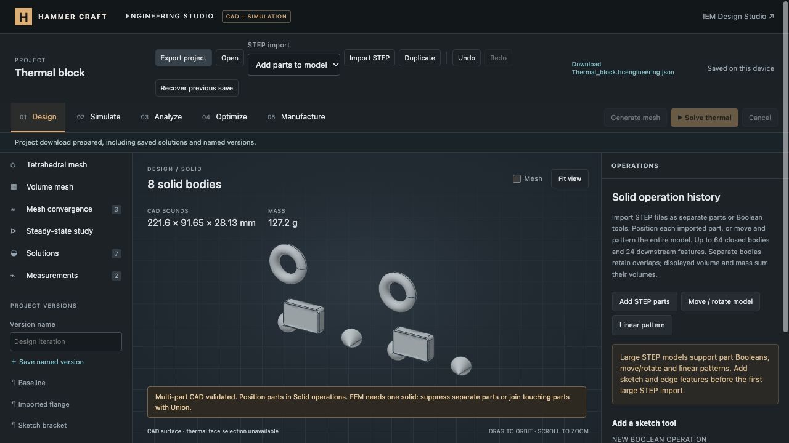

# Multi-STEP import and CAD tools — 16 October 2026

## Delivered

- Select several STEP files in one import. The toolbar defaults to **Add parts to model**; **Replace model** starts a model from the batch. Existing geometry is retained until the whole batch validates, and acceptance is one undoable edit.
- Import closed multi-body STEP files as well as individual solids. Maximum 64 bodies and 24 downstream features. Each input file retains the 1.5 GB upload limit; embedded sources up to 1 MiB use browser Open CASCADE, larger sources use the local Rust service.
- Each additional STEP part has editable XYZ translation and rotation, and separate-body / union / subtract / intersect modes. Rotation is about the world origin in X, Y, Z order, then translation. Values accept unit expressions and parameters.
- Duplicate an imported part, move/rotate the whole upstream model, or create a linear pattern of 2–20 instances. Existing suppression, reorder, remove, undo, named versions and project export work with these features.
- Native geometry combines browser-built prefixes with large uploaded parts. The service resolves stored digest references, rejects client-selected paths, applies the native operations, and saves the final STEP by content hash. Export and FEM use the final generated geometry.
- Corrected a browser-specific fetch receiver error found during the final native STEP download check. The regression suite now checks that fetch is invoked without a CAD-client receiver.

## Verification

- Full JavaScript suite: **585 passed**, no failures/skips, 42.44 s.
- After tightening per-stage multi-body validation: **43 focused CAD/history/upload tests passed**.
- After the browser fetch fix: **7 upload/native CAD tests passed**. After final multi-body FEM UI gating: **11 meshing tests passed**; both mesh buttons were visibly disabled with the single-solid explanation.
- Rust: **11 tests passed**, Clippy with warnings as errors passed; formatting and native release build passed.
- Python: **36 tests passed**.
- Real geometry tests cover separate solid counts/volumes, per-part rotation/translation, Boolean expected volumes, empty intersection rejection, whole-model transforms, pattern spacing/body limits, STEP round trips, project/history/version references, native generated units, current-geometry FEM meshing and nested-path rejection.

Browser checks imported sphere and cone STEP files in one selection onto the existing rounded/chamfered plate, moved/rotated the cone, then added a 2,004,143-byte torus through the native service. Moving the torus and creating a linear pattern produced **eight solid bodies**, **47,093.51 mm³** total volume. Reload regenerated the model. Named version **Multi-part CAD** retains the example. The prior **Rust DC plate** design was restored and saved afterward, with the new Solid operations controls left open.

The actual project download passed production validation with all seven history features, original stored-source reference and 16 named versions. [Project evidence](browser-project.json). The actual browser STEP download was independently read by browser Open CASCADE and retained **eight solids** and **47,093.5087 mm³** volume with correct units. [STEP export evidence](browser-step-export.json).

## Limits

FEM still requires one solid body; suppress separate parts or union touching parts first. Separate bodies retain overlaps, so volume/mass sum each body's contribution. All bodies use one assigned project material. There are no assembly mates, per-part materials, component picking in the viewport, imported hierarchy or face-level direct edits. Native downstream tools currently cover STEP Boolean operands, transforms and linear patterns; browser sketch/edge operations must precede the first large STEP import. Large-file byte acceptance is not a promise that arbitrary model complexity fits memory or preview limits.

The earlier reported 44 KB curved STEP has not been supplied, so its specific rejection has not been diagnosed. These tests do not establish a fix for that file.

Changes are local. No commit, push or production deployment was performed.
