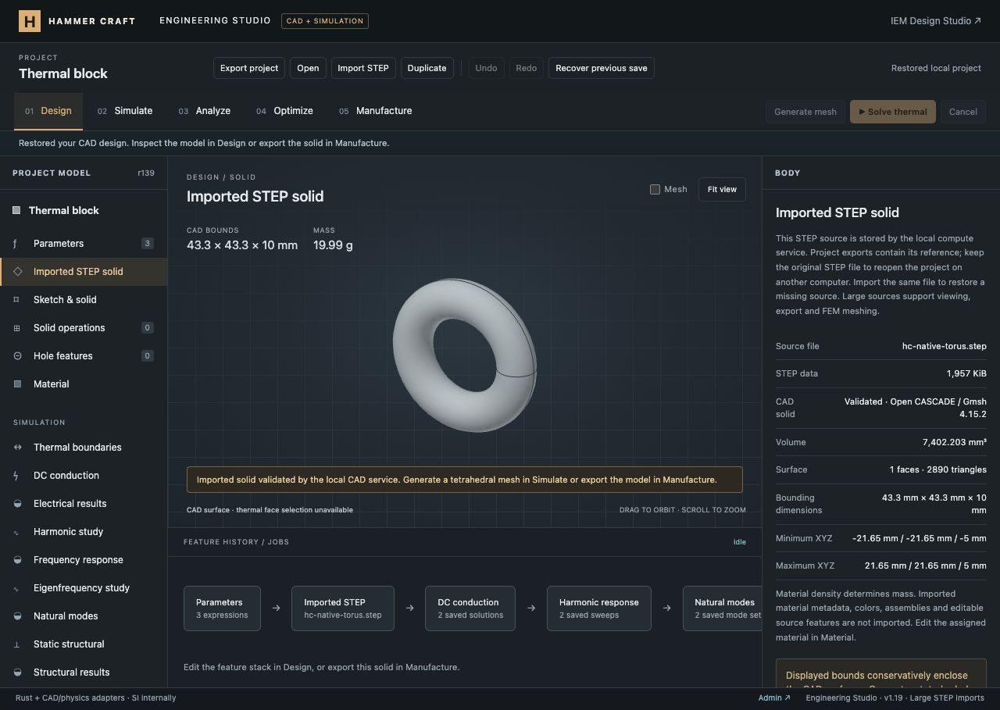

# STEP upload and curved-solid checks — 16 October 2026

## Delivered

STEP import accepts up to **1.5 GB (1,500,000,000 bytes)**. Files up to 1 MiB retain the existing browser CAD workflow and self-contained project text. Larger files stream to the local Rust service, which hashes and stores them on disk and invokes native Gmsh/Open CASCADE for preview. Project history and exports retain compact SHA-256/size references instead of copying large strings. Reimporting an identical original restores its reference on another computer.

The stored-source path supports viewing, original STEP download, preview STL export and tetrahedral FEM meshing. Native import jobs can be cancelled and time out after 15 minutes; uploads time out after 30 minutes. Temporary partial uploads are removed. Completed files persist in the ignored `tools/engineering-compute/.step-assets/` directory. HTTP Host/Origin/custom-header checks remain enforced; client-supplied filesystem paths are rejected by both services. The normal JSON request cap remains 10 MiB.

Large-source Boolean/edge editing is not implemented. The UI explains this and does not offer those editing controls for stored imports. The 64 MiB portable-project limit remains, because large STEP bodies are referenced separately. Native previews are bounded to 200,000 nodes / 150,000 triangles; arbitrary 1.5 GB geometric complexity is not guaranteed to fit RAM or finish. Native CAD boxes are conservative enclosures, not exact metrology dimensions.

## Verification

- **578 JavaScript tests passed**, zero failures/skips (41.18 s), including legacy CAD/project/physics workflows.
- Final focused CAD/upload run: **23 passed** after clearer validation errors and additional STL-volume checks. The upload suite was rerun after making its Python selection portable for CI: **5 passed**.
- **11 Rust tests** and **36 Python tests passed**. Rustfmt, Clippy with warnings as errors, native release build and JavaScript syntax checks passed.
- Real **1,500,000,000-byte** streamed upload, disk-size verification, native parse and preview completed. Transfer took 2.941 s and parse/poll/over-limit check 5.021 s on this machine. A declared 1,500,000,001-byte upload was rejected with HTTP 413. The test used a valid torus padded with whitespace, so it measures the full file path, not the complexity of a 1.5 GB CAD assembly. Exact data: [large-upload.json](large-upload.json).
- Tests check interrupted-upload cleanup, upload-slot release, wrong origin/missing header rejection, malformed/binary STEP rejection, missing asset errors, arbitrary-path rejection, original-byte download, compact project/history references, native preview, STL orientation/volume and stored-source tetrahedral meshing.
- Actual browser Open CASCADE imports/exports closed spheres, cones, tori, NURBS spheres and NURBS cylinders. These retain positive volume and finite tessellation across round trips.

## Browser verification

Imported a 2,004,143-byte padded torus through the website's Import STEP control. The source rendered with 2,890 triangles and 7,402.203 mm³ volume. Reload restored the source through the native service. Named version “Large STEP import” and project download were verified; importing the exported JSON preserved its compact asset reference and 15 named versions. The UI correctly explains native editing limits. The earlier “Rust DC plate” design was restored afterward, keeping the test as a named version. [Project export summary](browser-project.json).

## Reported 44 KB file

The user's specific file has not been supplied. The reported “invalid geometry” error therefore remains **unreproduced and unresolved for that file**. Curvature itself is supported by both paths. The existing validator now distinguishes missing/multiple solids from invalid face/edge topology and explains that open surfaces must be exported as closed solids. It still checks geometry; validation was not disabled to accept bad models. The actual failing file is required to determine whether it has gaps, seam/curve problems, unsupported topology or a separate importer defect.

Changes are local; no commit, push or production deployment was performed in this turn.
